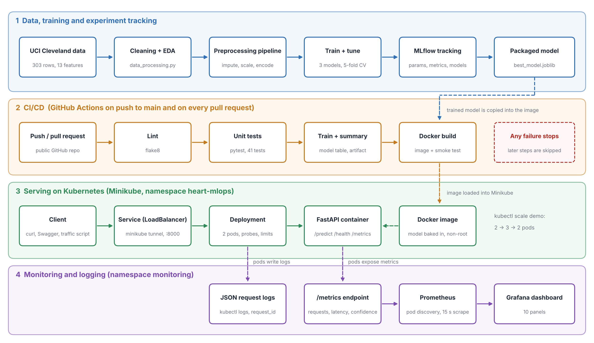

# Heart Disease Risk Prediction - MLOps Assignment 01


End-to-end ML project (BITS Pilani, AIMLCZG523): predict the presence of heart disease from
patient health data using the UCI Heart Disease (Cleveland) dataset, then track, test, containerise,
deploy and monitor the model.

> Status: complete - data + EDA, training with MLflow, FastAPI service, tests, CI/CD, Docker, Kubernetes (Minikube) and Prometheus/Grafana monitoring.



**Results (hold-out test set, 61 patients):** selected model = logistic regression, ROC-AUC 0.967, recall 0.929, accuracy 0.885 (5-fold CV ROC-AUC 0.902). Three models were compared; see `reports/model_comparison.csv`.

**Evidence:** screenshots of every stage are in `screenshots/` (files `01_` to `11_`), including a deliberately failing pull request (`11_*`) that shows CI blocking bad code. A second, independent run of the whole pipeline on the BITS Prayogshala lab VM is in the same folder (files `lab_02_*` to `lab_12_*`). The full written report is submitted separately.

**Demo video:** full quality on [Google Drive](https://drive.google.com/file/d/1l1NyGt8uGgFhaOEbg-KFtx0vx-AS1yjG/view?usp=drive_link) (about 115 MB), and a compressed copy (about 20 MB) in this repository: [open or download `MLOPS_Assignment1_2025AE05336.mp4`](https://github.com/vankudrv/heart-disease-mlops/raw/main/video/MLOPS_Assignment1_2025AE05336.mp4). GitHub cannot preview a video this size on the file page, so use the link above or the Raw button.

## Setup (Windows PowerShell)

```powershell
python -m venv .venv
.venv\Scripts\activate
pip install -r requirements.txt
```

## Get the data

```powershell
python scripts/download_data.py      # downloads data/raw/processed.cleveland.data from UCI
python src/data_processing.py        # writes data/processed/heart_clean.csv
```

If the download fails, get `processed.cleveland.data` from
<https://archive.ics.uci.edu/dataset/45/heart+disease> and put it in `data/raw/`.

## Run the EDA

Open `notebooks/01_eda.ipynb` in VS Code, choose the `.venv` kernel, and click **Run All**.
Figures are saved to `reports/figures/`.

## Train and track experiments

```powershell
python -m src.train                       # trains 3 models, logs everything to MLflow, saves models/best_model.joblib
python -m src.train --no-fe --no-save     # ablation: same experiment without the engineered feature
mlflow ui                                 # then open http://127.0.0.1:5000
python -m src.predict                     # sample prediction with the saved model
```

Models: Logistic Regression, Random Forest, Gradient Boosting, each tuned with 5-fold stratified
cross-validated grid search on an 80% training split; a 20% stratified hold-out set is used only for
the final test metrics. Selection rule: highest CV ROC-AUC, ties (within 0.01) broken by CV recall.

## Run the API locally

```powershell
python -m uvicorn src.api.main:app --port 8000
```
Interactive docs: <http://127.0.0.1:8000/docs>. In a second terminal:

```powershell
Invoke-RestMethod -Uri http://127.0.0.1:8000/predict -Method Post -ContentType "application/json" -Body (Get-Content samples/sample_patient.json -Raw)
Invoke-RestMethod http://127.0.0.1:8000/health
```
Metrics for Prometheus: <http://127.0.0.1:8000/metrics>. Every request is logged as one JSON line
to the console and to `logs/api.log` (patient inputs are only logged if `LOG_INPUTS=true`).

## Docker

```powershell
python scripts/pin_api_requirements.py        # pin the image's dependencies to your training environment
docker build -t heart-disease-api:1.0 .
docker run --rm -p 8000:8000 --name heart-api heart-disease-api:1.0
```
Then call `http://127.0.0.1:8000/predict` exactly as above. The image contains only the API code, the
trained model (`models/`) and the slim dependencies in `requirements-api.txt`; it runs as a non-root
user and has a health check.

## CI pipeline (GitHub Actions)

`.github/workflows/ci.yml` runs on every push and pull request:
1. **lint-test-train**: flake8, pytest (JUnit report), model training with MLflow tracking, model
   comparison table in the job summary, and the models/reports/mlruns uploaded as an artifact.
2. **docker-build-and-test**: builds the image, starts the container and smoke-tests `/health` and `/predict`.

A failing lint, test, training or container step fails the pipeline and shows the log of that step.
The workflow triggers on pushes to `main` and on every pull request, so a change on a feature branch is checked as soon as a pull request is opened.

## Kubernetes (Minikube)

```powershell
minikube start --driver=docker --cpus=2 --memory=3072
minikube image load heart-disease-api:1.0        # make the locally built image available inside the cluster
kubectl apply -k k8s/                            # namespace + deployment (2 pods) + LoadBalancer service
kubectl get pods,svc -n heart-mlops
minikube tunnel                                  # separate terminal, keep running: gives the service an external IP
```
Then call the API on the service's EXTERNAL-IP, port 8000. Scale with
`kubectl scale deployment heart-api -n heart-mlops --replicas=3`. Manifests are in `k8s/`.

## Tests and lint

```powershell
pip install -r requirements-dev.txt
python -m pytest
python -m flake8 src tests
```

## Project layout

```
data/raw, data/processed   raw UCI file and cleaned CSV
scripts/download_data.py   dataset download script
src/data_processing.py     loading + cleaning (no leakage-prone steps)
src/preprocessing.py       feature engineering + imputation/scaling/encoding pipeline
src/train.py               tuning, evaluation, MLflow tracking, model saving
src/predict.py             load model + predict (reused by the API)
src/api/                   FastAPI app (main.py), request schemas, JSON logging
samples/                   example patient JSON files for testing the API
tests/                     pytest unit tests (data, preprocessing, model, API)
Dockerfile, .dockerignore  container image for the API
requirements-api.txt       slim pinned dependencies for the image
.github/workflows/ci.yml   CI pipeline
models/                    best_model.joblib + model_metadata.json (created by training)
notebooks/01_eda.ipynb     exploratory data analysis
reports/figures/           saved plots
tests/, k8s/, monitoring/, .github/workflows/   added in later phases
screenshots/               evidence for the report (lab_* = run on the BITS lab VM)
```

## Data attribution
Hungarian Institute of Cardiology (A. Janosi), University Hospital Zurich (W. Steinbrunn),
University Hospital Basel (M. Pfisterer), V.A. Medical Center Long Beach and Cleveland Clinic
Foundation (R. Detrano). Donor: David W. Aha (1988).


## Monitoring (Prometheus + Grafana on Minikube)

```powershell
kubectl apply -k monitoring/
kubectl get pods -n monitoring
kubectl port-forward -n monitoring svc/grafana 3000:3000        # http://localhost:3000  (admin / admin)
kubectl port-forward -n monitoring svc/prometheus 9090:9090     # http://localhost:9090/targets
python scripts/generate_traffic.py --requests 300 --delay 0.2   # needs `minikube tunnel` running
kubectl logs -n heart-mlops -l app=heart-api --tail=500 | Select-String '"/predict"'
```

## Running on the BITS lab VM (Linux, bash)

The same steps were repeated on the lab VM (Rocky Linux 9.5, Python 3.12, Docker 28, Minikube 1.35).
`kubectl` is not installed there, so a one-line wrapper around `minikube kubectl` is used, and the
service is reached with `kubectl port-forward` instead of `minikube tunnel`. Only `~/workspace` persists
between lab sessions, so keep the clone there.

```bash
cd ~/workspace && git clone https://github.com/vankudrv/heart-disease-mlops.git && cd heart-disease-mlops
python3 -m venv .venv && source .venv/bin/activate && pip install -r requirements-dev.txt
python -m pytest -q && python -m flake8 src tests
python -m src.train && git checkout -- models/        # restore the committed, version-pinned model
docker build -t heart-disease-api:1.0 .
mkdir -p ~/workspace/bin && printf '#!/bin/sh\nexec minikube kubectl -- "$@"\n' > ~/workspace/bin/kubectl && chmod +x ~/workspace/bin/kubectl
export PATH=$HOME/workspace/bin:$PATH
minikube start --driver=docker --cpus=2 --memory=4096
minikube image load heart-disease-api:1.0 && kubectl apply -k k8s/ && kubectl apply -k monitoring/
kubectl port-forward -n heart-mlops svc/heart-api 8000:8000 &
python scripts/generate_traffic.py --requests 300 --delay 0.2
```
